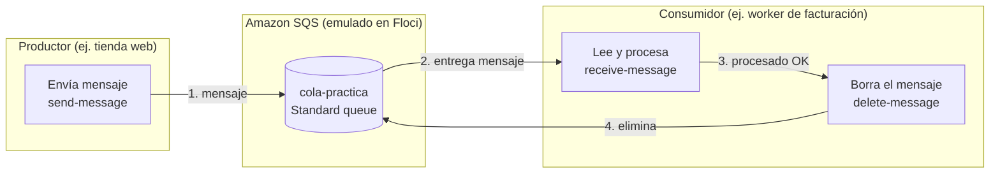
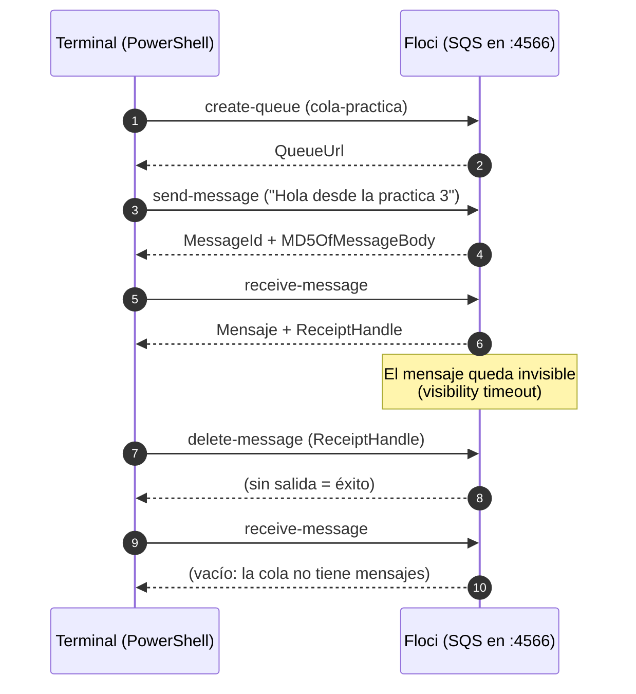
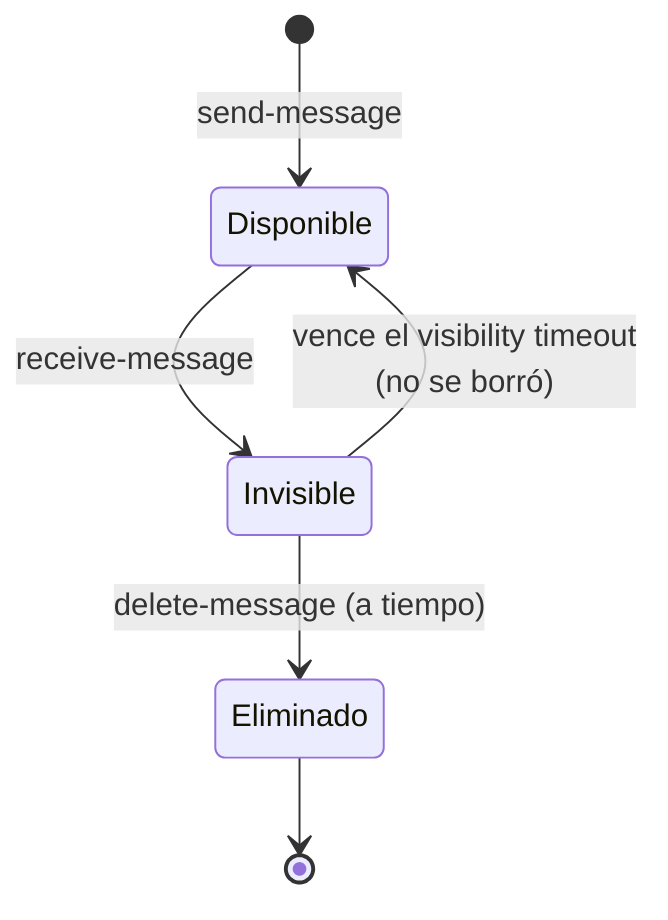
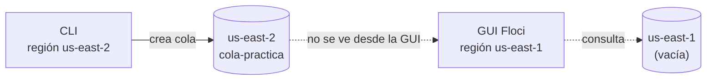

# Práctica 3 — Colas de mensajes con Amazon SQS (en Floci)

> **Nivel:** básico · **Servicio AWS:** SQS · **Entorno:** Floci (emulador local de AWS) · **Shell:** PowerShell en Windows 11

---

## 📌 Tabla de contenido

1. [Objetivo](#-objetivo)
2. [Escenario real](#-escenario-real-donde-se-usa-esto)
3. [Arquitectura](#-arquitectura)
4. [Conceptos clave](#-conceptos-clave)
5. [Requisitos](#-requisitos-previos)
6. [Estructura de la carpeta](#-estructura-de-la-carpeta)
7. [Paso a paso](#-paso-a-paso)
8. [Resultado esperado](#-resultado-esperado)
9. [Verificación en la GUI de Floci](#-verificación-en-la-gui-de-floci)
10. [Problemas comunes](#-problemas-comunes)
11. [Limpieza](#-limpieza)
12. [Lo que aprendí](#-lo-que-aprendí)
13. [Siguientes pasos](#-siguientes-pasos)

---

## 🎯 Objetivo

Aprender el patrón **productor → cola → consumidor** con Amazon SQS, ejecutando el ciclo completo de un mensaje:

| # | Acción | Comando AWS CLI |
|---|--------|-----------------|
| 1 | Crear una cola | `sqs create-queue` |
| 2 | Obtener su URL | `sqs get-queue-url` |
| 3 | Enviar un mensaje | `sqs send-message` |
| 4 | Recibir el mensaje | `sqs receive-message` |
| 5 | Borrar el mensaje | `sqs delete-message` |
| 6 | Verificar que la cola quedó vacía | `sqs receive-message` |

Todo se practica **sin costo y sin cuenta de AWS**, usando Floci como emulador local.

---

## 🏢 Escenario real: ¿dónde se usa esto?

Imagina una **tienda en línea**. Cuando un cliente paga, la página web debe:

- guardar el pedido,
- enviar el correo de confirmación,
- descontar inventario,
- generar la factura.

Si la web hiciera todo eso **en el mismo momento**, el cliente esperaría varios segundos, y si el servicio de facturación se cae, **el pedido falla**.

Con SQS, la web solo deja un mensaje en una cola ("pedido #1234 pagado") y responde al cliente de inmediato. Un servicio aparte (el *worker*) lee los mensajes y hace el trabajo pesado a su ritmo.

| Sin cola | Con cola (SQS) |
|----------|----------------|
| La web espera a que todo termine | La web responde al instante |
| Si facturación se cae, el pedido se pierde | El mensaje espera en la cola hasta que facturación vuelva |
| Los picos de tráfico saturan los servicios | La cola absorbe el pico y los workers lo procesan poco a poco |
| Todo está acoplado | Cada servicio es independiente |

Esta práctica reproduce ese patrón en pequeño: tu terminal hace de *productor* y de *consumidor*.

---

## 🏗️ Arquitectura

### Vista general



### Flujo de la práctica (secuencia)



### Ciclo de vida de un mensaje



> 💡 **Por qué importa:** si el consumidor lee un mensaje pero se cae antes de borrarlo, el mensaje **vuelve a estar disponible** y otro worker lo procesa. Así no se pierden pedidos.

---

## 📚 Conceptos clave

| Concepto | Explicación |
|----------|-------------|
| **Cola (queue)** | Buzón donde esperan los mensajes. Se identifica por una URL. |
| **Mensaje** | Texto de hasta 256 KB. |
| **Productor** | Quien envía mensajes a la cola. |
| **Consumidor** | Quien lee y procesa mensajes. |
| **Visibility timeout** | Tiempo (30 s por defecto) en que un mensaje leído queda oculto para otros consumidores. |
| **ReceiptHandle** | Identificador temporal que entrega `receive-message` y que se necesita para borrar el mensaje. |
| **Standard vs FIFO** | *Standard*: alto rendimiento, orden no garantizado. *FIFO* (nombre termina en `.fifo`): orden estricto. |
| **Región** | Las colas pertenecen a una región (ej. `us-east-1`). Ver [Problemas comunes](#-problemas-comunes). |

---

## ✅ Requisitos previos

- Floci en ejecución, escuchando en `http://localhost:4566`.
- [AWS CLI](https://docs.aws.amazon.com/cli/latest/userguide/getting-started-install.html) instalado (`aws --version`).
- Credenciales de prueba configuradas (`aws configure`). Con Floci sirven valores ficticios.
- PowerShell en Windows 11.

Comprueba que todo responde:

```powershell
aws --version
aws --endpoint-url http://localhost:4566 sqs list-queues
```

---

## 📁 Estructura de la carpeta

```text
03-sqs/
├── README.md          # Este documento
├── sqs-basico.ps1     # Script con el ciclo completo
└── img/               # Capturas de pantalla
    ├── 01-terminal.png
    └── 02-gui-sqs.png
```

---

## 🚀 Paso a paso

### Script completo: `sqs-basico.ps1`

```powershell
# ------------------------------------------------------------
# Práctica 3 - SQS en Floci
# Ciclo completo: crear cola, enviar, recibir y borrar un mensaje
# ------------------------------------------------------------

$endpoint = "http://localhost:4566"
$region   = "us-east-1"          # Debe coincidir con la región que usa la GUI de Floci
$queue    = "cola-practica"

# 1. Crear la cola
aws --endpoint-url $endpoint --region $region sqs create-queue --queue-name $queue

# 2. Obtener la URL de la cola
$queueUrl = aws --endpoint-url $endpoint --region $region sqs get-queue-url `
  --queue-name $queue --query QueueUrl --output text

# 3. Enviar un mensaje (rol: productor)
aws --endpoint-url $endpoint --region $region sqs send-message `
  --queue-url $queueUrl --message-body "Hola desde la practica 3"

# 4. Recibir el mensaje (rol: consumidor)
$resp = aws --endpoint-url $endpoint --region $region sqs receive-message `
  --queue-url $queueUrl | ConvertFrom-Json
$resp.Messages[0].Body

# 5. Borrar el mensaje usando su ReceiptHandle
aws --endpoint-url $endpoint --region $region sqs delete-message `
  --queue-url $queueUrl --receipt-handle $resp.Messages[0].ReceiptHandle

# 6. Verificar que la cola quedó vacía (no debe mostrar nada)
aws --endpoint-url $endpoint --region $region sqs receive-message --queue-url $queueUrl
```

### Ejecución

```powershell
cd 03-sqs
.\sqs-basico.ps1
```

### Qué hace cada paso

| Paso | Qué ocurre | Qué verás |
|------|-----------|-----------|
| 1 | Se crea la cola `cola-practica` | JSON con `QueueUrl` |
| 2 | Se guarda la URL en una variable | (sin salida) |
| 3 | Se envía el mensaje | `MessageId` y `MD5OfMessageBody` |
| 4 | Se lee el mensaje | El texto `Hola desde la practica 3` |
| 5 | Se elimina el mensaje | (sin salida = éxito) |
| 6 | Se consulta la cola de nuevo | (sin salida = cola vacía) |

---

## 🖥️ Resultado esperado

```text
PS> .\sqs-basico.ps1
{
    "QueueUrl": "http://localhost:4566/000000000000/cola-practica"
}

{
    "MD5OfMessageBody": "66c78a788fa723d55fbd963f782a198e",
    "MessageId": "e4d3c5a9-f4d5-4ae7-a904-e408a883f8e5"
}

Hola desde la practica 3
```

> 📝 El `MessageId` cambia en cada ejecución. El `000000000000` es el ID de cuenta que usa el emulador.


---

## 🔎 Verificación en la GUI de Floci

1. Abre Floci UI en `http://localhost:4500`.
2. En el menú lateral entra en **Integration → SQS**.
3. Confirma que la **región** de la GUI coincide con la de tu CLI.
4. Pulsa **Refresh**. Debe aparecer `cola-practica`.

Como el script borra el mensaje, la cola se verá con **0 mensajes**. Para ver uno en la GUI, envíalo sin borrarlo:

```powershell
aws --endpoint-url http://localhost:4566 --region us-east-1 sqs send-message `
  --queue-url http://localhost:4566/000000000000/cola-practica `
  --message-body "Mensaje para ver en la GUI"
```

También puedes consultar el contador por CLI:

```powershell
aws --endpoint-url http://localhost:4566 --region us-east-1 sqs get-queue-attributes `
  --queue-url http://localhost:4566/000000000000/cola-practica `
  --attribute-names ApproximateNumberOfMessages
```


---

## 🛠️ Problemas comunes

### La cola existe por CLI pero la GUI muestra "No AWS SQS found"

**Causa:** los recursos de AWS son **regionales**. Si la CLI crea la cola en `us-east-2` y la GUI consulta `us-east-1`, no la verá.

**Cómo diagnosticarlo:**

```powershell
aws configure get region                                  # región por defecto de tu CLI
aws --endpoint-url http://localhost:4566 --region us-east-1 sqs list-queues
aws --endpoint-url http://localhost:4566 --region us-east-2 sqs list-queues
```

**Solución:** usar siempre la misma región (por eso el script define `$region`), o cambiar la región por defecto:

```powershell
aws configure set region us-east-1
```



### `receive-message` no devuelve nada justo después de leer

Es normal: el mensaje está dentro del *visibility timeout* y está oculto para otros consumidores.

### `Cannot index into a null array` al leer `$resp.Messages[0]`

No había mensajes en la cola (ya se borraron o aún no se enviaron). Envía uno nuevo y vuelve a intentar.

### `Could not connect to the endpoint URL`

Floci no está corriendo o usa otro puerto. Verifica que el contenedor esté activo.

---

## 🧹 Limpieza

Para eliminar la cola al terminar:

```powershell
aws --endpoint-url http://localhost:4566 --region us-east-1 sqs delete-queue `
  --queue-url http://localhost:4566/000000000000/cola-practica
```

---

## 🧠 Lo que aprendí

- SQS **desacopla** servicios: el productor no espera al consumidor.
- Leer un mensaje **no lo elimina**: hay que borrarlo explícitamente con su `ReceiptHandle`.
- El **visibility timeout** evita que dos workers procesen el mismo mensaje a la vez y permite reintentos si uno falla.
- Los recursos de AWS son **regionales**: CLI y consola deben apuntar a la misma región.
- Un emulador como Floci permite practicar con la misma CLI y los mismos comandos que se usan en AWS real, solo cambiando `--endpoint-url`.

---

## ⏭️ Siguientes pasos

- **Dead Letter Queue (DLQ):** enviar a otra cola los mensajes que fallan varias veces.
- **SNS + SQS:** publicar un evento y que varias colas lo reciban (*fan-out*).
- **Lambda como consumidor:** procesar automáticamente cada mensaje que llegue.

---

📂 **Práctica anterior:** [02-iam](../02-iam) · 🏠 **Repositorio:** [volver al índice](../README.md)
